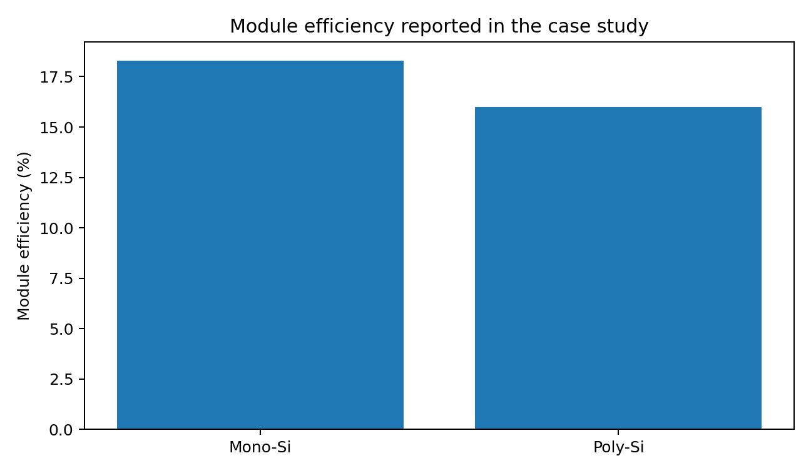
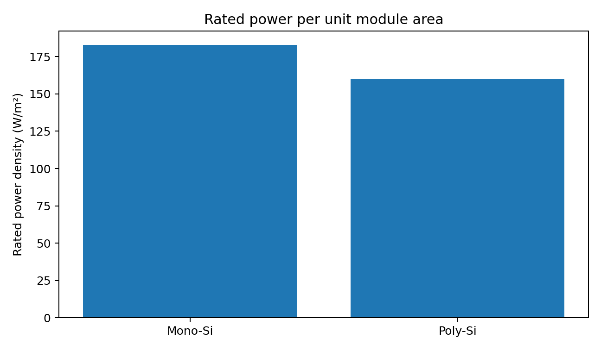
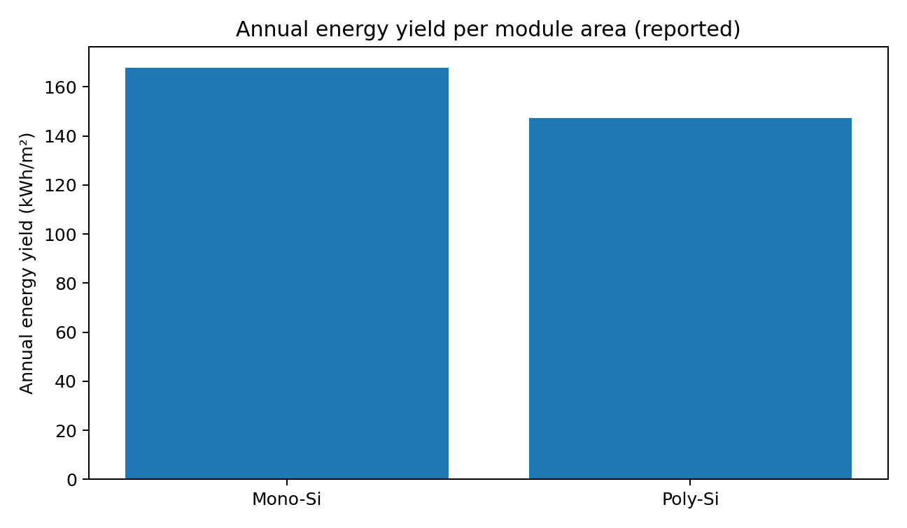
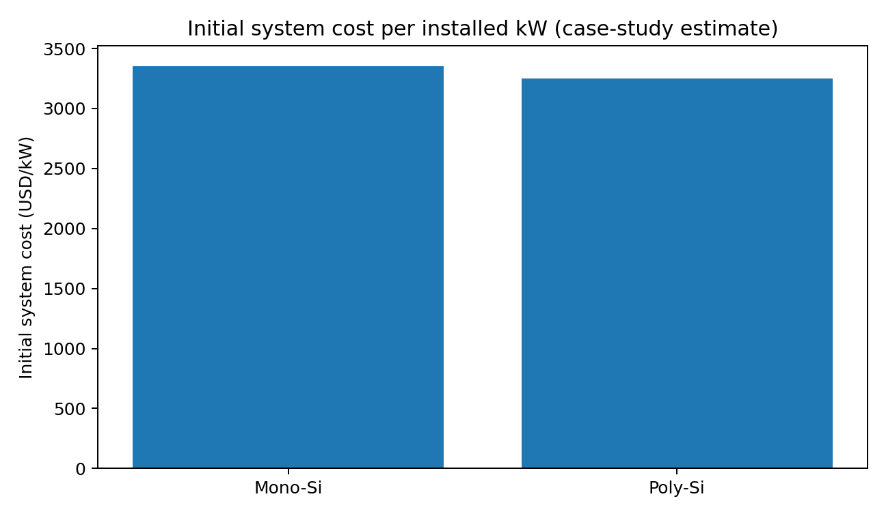

# Comparative Analysis and Selection of Solar PV Modules

A Python-based engineering comparison of **monocrystalline (Mono-Si)** and **polycrystalline (Poly-Si)** photovoltaic (PV) modules. The project uses published case-study data to examine module specifications, power density, installed capacity, energy yield and project-level cost indicators.

> **Scope note:** This repository is a secondary-data analysis of two specific PV system configurations reported in a published study. It is not a laboratory experiment, a live market-price survey, or a universal ranking of all monocrystalline and polycrystalline products.

---

## Contents

- [Project objective](#project-objective)
- [Why compare these technologies?](#why-compare-these-technologies)
- [Dataset and source](#dataset-and-source)
- [Project structure](#project-structure)
- [Tools and libraries](#tools-and-libraries)
- [Methodology and calculations](#methodology-and-calculations)
- [Results and visualisations](#results-and-visualisations)
- [Engineering interpretation](#engineering-interpretation)
- [How to run the project](#how-to-run-the-project)
- [Limitations](#limitations)
- [Possible extensions](#possible-extensions)
- [References](#references)

## Project objective

To compare one published monocrystalline rooftop PV configuration with one polycrystalline configuration and understand the trade-offs between:

1. Module conversion efficiency and rated output.
2. Rated power per unit module area.
3. Installed system capacity.
4. Initial system cost per installed kilowatt.
5. Reported annual energy yield per installed kilowatt and per unit module area.
6. Estimated payback period under the source study's assumptions.

The intended engineering use is **preliminary technology screening**. A real industrial procurement decision would additionally require site-specific solar-resource assessment, current vendor quotations, warranty review and balance-of-system costing.

## Why compare these technologies?

Monocrystalline and polycrystalline modules are both crystalline-silicon PV technologies, but their cell structures and commercial characteristics differ. In general, module efficiency matters when rooftop area is limited, while purchase and installation cost matter when the project is budget-constrained. The economically preferable option therefore depends on the project conditions rather than efficiency alone.

## Dataset and source

The repository contains [`curated_module_comparison.csv`](curated_module_comparison.csv), a **curated secondary dataset** transcribed from the numerical tables and results in the following open-access paper:

**Shi, K., Li, C., & Koo, C. (2021).** “A Techno-Economic Feasibility Analysis of Mono-Si and Poly-Si Photovoltaic Systems in the Rooftop Area of Commercial Building under the Feed-In Tariff Scheme.” *Sustainability*, 13(9), 4709.  
https://doi.org/10.3390/su13094709

The paper studies a commercial-building rooftop scenario in Hong Kong and reports the following module configurations:

| Parameter | Monocrystalline | Polycrystalline |
|---|---:|---:|
| Module model | CSUN355-72M | CSUN310-72P |
| Rated power per module | 355 W | 310 W |
| Reported module efficiency | 18.30% | 16.00% |
| Module dimensions | 1.96 × 0.99 m | 1.96 × 0.99 m |
| Number of modules in studied system | 832 | 832 |
| Installed system capacity | 295.36 kW | 257.92 kW |

**Data provenance and integrity:** The article is open access, but the CSV in this repository is not the paper's raw monitoring dataset. It is a small table of published values curated for reproducible comparison. The source study's cost and payback figures reflect its own historical Hong Kong project assumptions and must not be presented as current Indian prices.

## Project structure

```text
Solar-PV-Module-Comparison/
├── README.md
├── analyze_solar_modules.py
├── curated_module_comparison.csv
├── key_results.json
├── Solar_PV_Module_Comparison_Report.pdf
└── outputs/
    ├── efficiency_comparison.png
    ├── power_density_comparison.png
    ├── energy_per_area.png
    └── cost_per_kw.png
```

## Tools and libraries

- **Python** — analysis workflow.
- **Pandas** — loading, organising and calculating with the tabular data.
- **Matplotlib** — generating comparison charts.
- **CSV** — portable dataset format.

No machine-learning model is used. The project focuses on engineering calculations, comparison and interpretation.

## Methodology and calculations

The script [`analyze_solar_modules.py`](analyze_solar_modules.py) loads the CSV, derives additional engineering indicators, prints a comparison table and generates the charts in `outputs/`.

### 1. Module area

\[
A_m = L \times W
\]

where \(L\) and \(W\) are the module length and width in metres.

### 2. Rated power density

\[
P_d = \frac{P_{rated}}{A_m}
\]

where rated power is in watts and module area is in square metres. This provides a simple nameplate-power-per-area comparison; it is not a measured field power density.

### 3. Installed cost per watt

\[
C_W = \frac{C_{system}\;(USD/kW)}{1000}
\]

This is derived from the source study's **system-level initial cost per installed kW**. It is not the retail price of an individual PV module.

### 4. Relative difference

For a metric where a higher value is being compared:

\[
\%\;difference = \left(\frac{Mono}{Poly}-1\right)\times100
\]

The interpretation depends on the metric. A positive difference is not automatically “better” for cost or payback.

## Results and visualisations

The following charts are generated from the curated dataset and calculated indicators.

### Module efficiency



The selected Mono-Si module is reported at 18.30% efficiency, compared with 16.00% for the selected Poly-Si module.

### Rated power density



The two modules have the same reported external dimensions. The 355 W Mono-Si module therefore has a higher rated power per unit module area than the 310 W Poly-Si module.

### Annual energy yield per module area



The source study reports 167.87 kWh/m² for the Mono-Si system and 147.29 kWh/m² for the Poly-Si system. These are results from the paper's particular system and site assumptions, not guaranteed yields for other locations.

### Initial system cost per installed kW



The source study estimates a lower initial system cost per installed kW for its Poly-Si configuration. This is a historical, project-specific estimate and not a current module price comparison.

## Engineering interpretation

The comparison illustrates why PV module selection should consider more than a single specification:

- **Where roof area is constrained:** the selected Mono-Si configuration is attractive because it has higher rated power density and higher reported annual energy yield per module area.
- **Where initial system cost and the source scenario's payback are emphasised:** the selected Poly-Si configuration has a lower estimated initial system cost per kW and a slightly shorter estimated payback in the study.
- **Overall:** the results do not establish one technology as universally superior. The suitable option depends on roof area, energy demand, local solar conditions, tariffs, supplier offers, warranties and total installed cost.

## How to run the project

### 1. Clone or download this repository

```bash
git clone <your-repository-url>
cd Solar-PV-Module-Comparison
```

### 2. Install dependencies

```bash
python -m pip install pandas matplotlib
```

### 3. Run the analysis

```bash
python analyze_solar_modules.py
```

The script reads `curated_module_comparison.csv`, prints the comparison and saves the charts to the `outputs/` directory. Run it from the project directory so the relative file paths resolve correctly.

## Limitations

1. **Small comparison set:** only two specific module/system configurations from one paper are compared. The findings are not statistically representative of all Mono-Si or Poly-Si products.
2. **Historical economics:** cost and payback figures belong to the source study's Hong Kong scenario and policy context. They should not be used as current Indian procurement estimates.
3. **System cost, not module price:** the source's initial cost per kW is a project/system-level estimate, not a quoted module-only price.
4. **Site dependence:** energy yield and payback depend on solar irradiance, orientation, tilt, shading, temperature, system losses, tariff and operating assumptions.
5. **No new physical testing:** no modules were fabricated or tested as part of this analysis; the work is based on published secondary data.
6. **No universal recommendation:** a current selection would need current datasheets and quotations, degradation and temperature coefficients, warranty terms, certifications, inverter and mounting costs, installation, operation and maintenance, financing and end-of-life considerations.

## Possible extensions

- Expand the dataset using current manufacturer datasheets from multiple suppliers.
- Add newer module variants such as mono PERC and TOPCon, ensuring that technologies and test conditions are compared consistently.
- Add temperature coefficient, degradation rate, warranty, bifaciality and module dimensions as selection criteria.
- Use site-specific solar irradiation and shading data to estimate annual energy generation.
- Compare full installed-system cost and calculate levelised cost of energy (LCOE) using transparent assumptions.
- Build a configurable decision matrix for different rooftop area, budget and energy-demand scenarios.

## References

1. Shi, K., Li, C., & Koo, C. (2021). A Techno-Economic Feasibility Analysis of Mono-Si and Poly-Si Photovoltaic Systems in the Rooftop Area of Commercial Building under the Feed-In Tariff Scheme. *Sustainability*, 13(9), 4709. https://doi.org/10.3390/su13094709
2. National Renewable Energy Laboratory (NREL), *Champion Photovoltaic Module Efficiency Chart*. https://www.nrel.gov/pv/module-efficiency.html

## Project report

A PDF report containing the methodology, comparison tables, charts, interpretation, limitations and references is included here: [Solar PV Module Comparison Report](Solar_PV_Module_Comparison_Report.pdf).

---

**Author:** Prateek Pathak  
**Project type:** Independent engineering data-analysis project  
**Focus:** Solar PV technology comparison, engineering calculations and data visualisation
